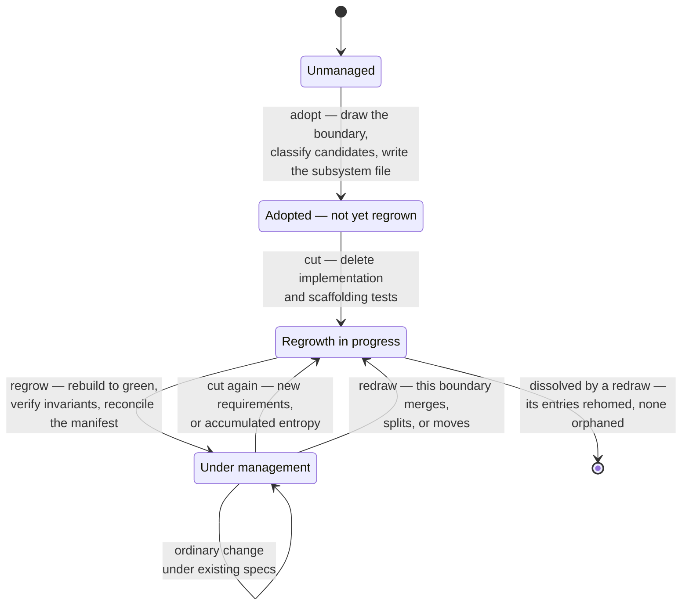

# Specs of Theseus

## Overview

The running system is replaceable material; the declared intent is the durable asset. Code and most tests are planks. The **spec manifest** and its **binding tests** are what make the system the same ship after every plank has been replaced.

**Change happens by regeneration, not accretion.** When requirements arrive, the move is not "patch this into the existing shape" but: decide what to delete so the system can be rethought *including* them, then regrow against the intent that survived.

Normal development accretes because deletion is frightening — the code is the only place intent is written down, so throwing it away loses knowledge. Once intent lives outside the code, deletion becomes husbandry. Entropy accumulates in implementations, not in intent.

Lineage: Chad Fowler's Regenerative Development / Phoenix Architecture.

## How work flows

Intent enters as an epic and reaches code as a task. Nothing is built that is not promised, and nothing is promised in a place that gets deleted.

Two diagrams, split by zoom. Nodes are activities; **the arrows are the artifacts passed between them**, and dotted means optional.

### Intent to tasks — [intent-to-tasks.mmd](references/intent-to-tasks.mmd)

Business need, product idea, or technical spike → epic → stories → backlog. The top story is analysed for what it touches, which routes to one of four moves: update specs on a managed subsystem, adopt existing code, grow a new subsystem, or redraw a boundary that no longer fits. All four converge on updating the manifest, which yields tasks.

**Regrowth has no node of its own.** When a story's manifest delta is large enough that patching would distort the subsystem, the cut becomes the story's first task. Deletion is a way of delivering a story, not a separate kind of work.

**The epic does not close straight back into the backlog.** It passes through the harvest, which folds the outcome into `docs/capabilities.md` — and the capability that comes out is an input to deciding what to build next.

### Building one task — [inner-loop.mmd](references/inner-loop.mmd)

Task → write test → run → implementation → green → refactor → annotate with spec tags → next task.

The dotted `Manifest Defect` arrow is the path that matters most and gets skipped most: discovering mid-cycle that the entry itself is wrong means going back to change it deliberately, never bending the test to fit. Refactoring is genuinely optional — which is why green has two exits — but skipping it silently is not.

## Lifecycle of a subsystem

The nodes are the statuses recorded in `docs/subsystems.md`; the arrows are the things you do.

A subsystem only reaches **Under management** by being regrown. Adoption alone declares intent; it does not prove the intent is sufficient to rebuild from. That proof is the regrowth.

**A subsystem can also stop existing.** A redraw may merge it, split it, or move its contents elsewhere — a legitimate end state, not a failure, provided no entry disappears with it.

**Never change code first and the manifest after.** The manifest is the statement of intent; code is its current expression. Reversing the order is how the record goes wrong — so a change that touches an invariant updates the manifest before a line of code moves.

## Vocabulary

| Term | Meaning |
| --- | --- |
| **Spec manifest** | `docs/subsystems.md` — the coverage index, with one file per subsystem in `docs/subsystems/`. The authoritative record of what the system promises. |
| **System** | The outermost boundary — `docs/system.md`. Inherits every subsystem's specs rather than restating them, and holds the cross-cutting invariants no subsystem owns. |
| **Subsystem** | A named area of the system with a boundary *you draw*; the unit that gets cut and regrown. It need not match an existing module, and it is not permanent. |
| **Boundary redraw** | A regrowth spanning more than one subsystem, changing the decomposition itself. Entries are rehomed, never orphaned. |
| **Invariant** | A property that must survive a total rewrite: exterior contract, performance characteristic, or high-level architecture |
| **Spec** | A behavioral promise, written in EARS |
| **Non-promise** | Behavior that exists today and is explicitly not promised |
| **Binding test** | Full-system, outcome-level test proving an invariant. Survives deletion. |
| **Scaffolding test** | Unit test on an implementation detail. Deleted with the code it describes. |
| **The cut** | The decision about what to delete before regrowing |
| **Capability** | A user-visible feature, named in `docs/capabilities.md`. A projection over manifest entries plus one durable sentence: the outcome. |
| **Epic** | A body of work larger than one story. Disposable — it records why a set of manifest changes happened. |
| **Story** | A vertical slice of an epic, independently deliverable. Disposable. Holds a manifest delta and its tasks. |
| **Manifest delta** | The entries a story adds, modifies, or retires. The story's promise, written and approved before any code moves. |
| **Task** | One red/green/refactor cycle, naming the entry it serves. Not written in EARS. |

## Durable vs disposable

| Durable — survives the cut | Disposable — deleted without ceremony |
| --- | --- |
| Manifest entries | Implementation code |
| Binding tests | Scaffolding tests |
| Exterior contracts, performance characteristics, architecture | Internal patterns, class decomposition, file layout, line count |
| Capability outcomes — why a feature was worth having | Epics, stories, and their task lists |
| — | **Subsystem boundaries** — the decomposition itself |

Implementation shape is free to change so long as invariants hold.

**The decomposition is disposable too.** Boundaries get drawn early, under maximum ignorance, and one never revisited becomes load-bearing by accident — the only structure no cut could reach. A redraw sheds that entropy; [system.md](references/system.md) carries the procedure.

What makes it safe: **the entry, not the subsystem, is the unit of obligation.** A rebuild may pick a different decomposition, so "Billing's invariants hold" is uncheckable against a system with no Billing. "Every active entry holds, wherever it now lives" is.

## Coverage is partial by design

`docs/subsystems.md` records which subsystems are under management. Code outside a covered subsystem is **not a violation** — it is simply not yet adopted. Never report unadopted code as drift, and never mass-adopt a codebase to make the manifest look complete.

## What the software does today

Four questions, four artifacts. Confusing them is how each one ends up asked to do a job it is the wrong shape for.

| Question | Artifact | Shape |
| --- | --- | --- |
| How did we get here? | `docs/epics.md` and its stories | event log, disposable |
| What must survive a rebuild? | `docs/subsystems.md` | state, durable, partial |
| What does it do today, and why is that worth having? | `docs/capabilities.md` | projection, durable |
| What holds no matter how it is decomposed? | `docs/system.md` | outermost boundary, durable |

**The union of active `SPEC` entries is what the software promises to do today** — the features are already in the manifest. What it lacks is a feature-shaped grouping and any statement of why a feature was worth having; [capabilities.md](references/capabilities.md) supplies both.

**Never reconstruct today's behavior from the epic list.** Stories are forward-facing and superseded ones stay written, so reading the work layer to find what exists gives a confidently wrong answer — the same defect as reading the code to find intent, one layer up.

## Freedom under constraint

When a new outcome arrives, "add specs to the existing subsystem" is one answer among several, and often not the honest one.

> An agent may propose any decomposition — a new subsystem, merged subsystems, redrawn boundaries — provided every active entry still has a home and still holds, and the system's cross-cutting invariants still hold. The decomposition is disposable; the entries are not.

Propose the shape alongside the manifest delta, in the same approval: a redraw carries the delta's weight, and discovering it mid-implementation is how it gets done badly.

Two bounds, both checkable:

- **No entry is orphaned.** Every active entry lands somewhere keeping its ID, or is retired visibly. A lost promise is silent — no test fails, because the test went with it.
- **Cross-cutting invariants hold throughout.** They belong to no subsystem, so no subsystem's regrowth will notice one breaking. Check them at every redraw. [system.md](references/system.md)

## Reference

- The outermost boundary, cross-cutting invariants, boundary redraw: [system.md](references/system.md)
- What the software does today, capability format, the harvest: [capabilities.md](references/capabilities.md)
- Manifest structure, entry templates, ID scheme: [manifest-format.md](references/manifest-format.md)
- Invariant categories, elicitation, classification gate: [invariants.md](references/invariants.md)
- EARS syntax for specs: [ears.md](references/ears.md)
- Binding vs scaffolding tests, tagging: [tests.md](references/tests.md)
- Epic, story, and task formats: [work-format.md](references/work-format.md)

## Routing

| Where you are | Skill |
| --- | --- |
| A need larger than one story, with no epic behind it | [refining-an-epic](../refining-an-epic/SKILL.md) |
| A refined epic that needs stories | [slicing-an-epic](../slicing-an-epic/SKILL.md) |
| The top story off the backlog | [delivering-a-story](../delivering-a-story/SKILL.md) |
| Existing code the story depends on, not in `docs/subsystems.md` | [adopting-a-subsystem](../adopting-a-subsystem/SKILL.md) |
| Behavior with no subsystem yet — greenfield | [growing-a-subsystem](../growing-a-subsystem/SKILL.md) |
| A property the whole product must hold to, owned by no subsystem — including over unmanaged code | [refining-an-epic](../refining-an-epic/SKILL.md), declaring `SYSTEM-INV` entries per [system.md](references/system.md) |
| A managed subsystem where patching would distort the shape, or entropy already has | [regrowing-a-subsystem](../regrowing-a-subsystem/SKILL.md) |
| The right boundary does not exist — the work needs a merge, a split, or a redraw | [regrowing-a-subsystem](../regrowing-a-subsystem/SKILL.md), redraw mode |

**Work normally enters at an epic**, and the subsystem-level skills are reached *through* a story. The exception is a regrowth driven by entropy alone with no product change behind it, which may be entered directly.

Anything smaller than all of this is an ordinary change under the existing specs — and saying so explicitly is a legitimate outcome, not a failure to find a process.

Read the satellite when you reach it. Do not reconstruct its process from this file.

## Common mistakes

| Mistake | Why it is wrong |
| --- | --- |
| **Procrustean spec** — spec legislates implementation detail | Cuts the code to fit the bed. Regeneration loses its freedom, and the spec breaks on every refactor. A spec constraining internal shape is a manifest defect. |
| **Black sail** — code changed, manifest not | The system works; the record lies; someone acts on the record. This is the failure mode the whole process exists to prevent. |
| **Enshrined entropy** — current behavior captured wholesale as binding tests | Makes the mess permanent in the artifact that is supposed to outlive it. Every candidate invariant gets classified before it becomes binding. |
| **Silent retirement** — deleting a spec that no longer applies | Retirement is visible. Record what was retired, what replaced it, and why. |
| **Adopting everything** | Partial coverage is legitimate. A thousand inferred specs written before you know what a good one looks like is worse than none. |
| **Specs written into a story** | The story is disposable; the spec dies with it. Specs are manifest entries — the story references them. |
| **A story with no manifest delta** | Either an ordinary change under existing specs, which should be said out loud, or unpromised behavior, which is a defect. |
| **Unharvested epic** — closed `done`, nothing folded into `capabilities.md` | The software gained a feature and the only record of it sits in the layer you may delete. |
| **Promises written into a capability** | A capability is a projection: every promise is a link, the outcome sentence the only original content. Two sources of truth is the black sail with extra steps. |
| **Regrowing along a capability** | Capabilities group code for reading, not for cutting — they cross the boundaries that make a cut survivable. Cut the subsystem, or redraw it deliberately. |
| **Orphaned entry** — a redraw loses a promise | Nothing downstream catches it. Rehome the entry or retire it visibly; never neither. |
| **Restated system entry** — a `SYSTEM-` entry copying a subsystem entry | The system inherits. Two copies of one promise, with two binding tests and no tiebreak. |
| **Promoting an entry to `SYSTEM-` for emphasis** | Cross-cutting means no subsystem owns it, not that it matters more. |
| **Mass-adopting to unlock whole-system regrowth** | A manifest of rushed entries makes a rebuild worse, not possible. Adopt because a regrowth is coming. |

## Red flags

- "I'll update the manifest after the code works"
- "This behavior is obviously intended, no need to classify it"
- "The existing tests tell us what the invariants are" — they assert implementation as often as intent
- "Let me just patch this in" for a change that clearly strains the subsystem's shape
- "Deleting the tests loses coverage" — scaffolding tests are supposed to die with their code
- "I'll write the epic up once we know what we built" — then the code wrote the intent
- "I'll adjust the spec to match what I implemented"
- "Read the epics if you want to know what it does" — that is a log, not a state
- "This epic must have delivered *something* worth listing" — hardening and entropy epics deliver no capability
- "The boundary is what it is, we'll work around it" — boundaries are disposable; say what a redraw would cost instead
- "That entry doesn't really fit anywhere in the new shape" — then retire it deliberately or you are about to orphan it

**All of these mean: stop and re-read this skill.**
