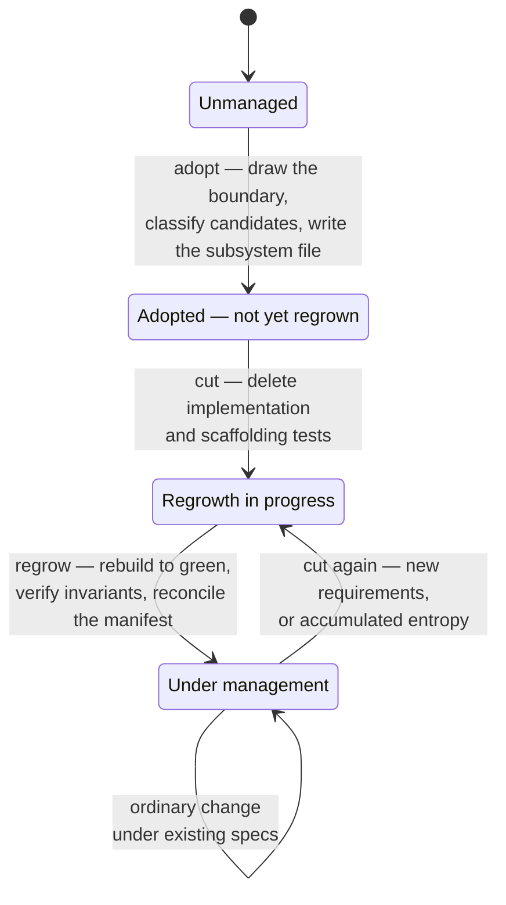

# Specs of Theseus

## Overview

The running system is replaceable material. The declared intent is the durable asset.

Code and most tests are planks. The **spec manifest** and its **binding tests** are what make the
system the same ship after every plank has been replaced.

**Change happens by regeneration, not accretion.** When requirements arrive, the move is not "patch
this into the existing shape." It is: decide what to delete so the system can be rethought
*including* the new requirements, then regrow it against intent that survived the deletion.

Normal development accretes because deletion is frightening — the code is the only place intent is
written down, so throwing it away loses knowledge. Once intent lives outside the code, deletion
becomes husbandry rather than destruction. Entropy accumulates in implementations, not in intent.

Lineage: Chad Fowler's Regenerative Development / Phoenix Architecture.

## Lifecycle of a subsystem

The nodes are the statuses recorded in `docs/subsystems.md`; the arrows are the things you do.

A subsystem only reaches **Under management** by being regrown. Adoption alone declares intent; it does
not prove the intent is sufficient to rebuild from. That proof is the regrowth.

**Never change code first and the manifest after.** The manifest is the statement of intent; code is
its current expression. Reversing the order is how the record goes wrong — so a change that touches
an invariant updates the manifest before a line of code moves.

## Vocabulary

| Term | Meaning |
| --- | --- |
| **Spec manifest** | `docs/subsystems.md` — the coverage index, with one file per subsystem in `docs/subsystems/`. The authoritative record of what the system promises. |
| **Subsystem** | A named area of the system with a boundary *you draw*; the unit that gets cut and regrown. It need not match an existing module. |
| **Invariant** | A property that must survive a total rewrite: exterior contract, performance characteristic, or high-level architecture |
| **Spec** | A behavioral promise, written in EARS |
| **Non-promise** | Behavior that exists today and is explicitly not promised |
| **Binding test** | Full-system, outcome-level test proving an invariant. Survives deletion. |
| **Scaffolding test** | Unit test on an implementation detail. Deleted with the code it describes. |
| **The cut** | The decision about what to delete before regrowing |

## Durable vs disposable

| Durable — survives the cut | Disposable — deleted without ceremony |
| --- | --- |
| Manifest entries | Implementation code |
| Binding tests | Scaffolding tests |
| Exterior contracts, performance characteristics, architecture | Internal patterns, class decomposition, file layout, line count |

Implementation shape matters less — but not zero. It is free to change so long as invariants hold.

## Coverage is partial by design

`docs/subsystems.md` records which subsystems are under management. Code outside a covered subsystem
is **not a violation** — it is simply not yet adopted. Never report unadopted code as drift, and
never mass-adopt a codebase to make the manifest look complete.

## Reference

- Manifest structure, entry templates, ID scheme: [manifest-format.md](references/manifest-format.md)
- Invariant categories, elicitation, classification gate: [invariants.md](references/invariants.md)
- EARS syntax for specs: [ears.md](references/ears.md)
- Binding vs scaffolding tests, tagging: [tests.md](references/tests.md)

## Satellite skills

- [**adopting-a-subsystem**](../adopting-a-subsystem/SKILL.md) — the subsystem is not in
  `docs/subsystems.md`
- [**regrowing-a-subsystem**](../regrowing-a-subsystem/SKILL.md) — the subsystem is managed, and the
  change is large enough that patching it would distort the shape, or entropy has already made it
  unmaintainable

Anything smaller is an ordinary change under the existing specs.

Read the satellite when you reach it. Do not reconstruct its process from this file.

## Common mistakes

| Mistake | Why it is wrong |
| --- | --- |
| **Procrustean spec** — spec legislates implementation detail | Cuts the code to fit the bed. Regeneration loses its freedom, and the spec breaks on every refactor. A spec constraining internal shape is a manifest defect. |
| **Black sail** — code changed, manifest not | The system works; the record lies; someone acts on the record. This is the failure mode the whole process exists to prevent. |
| **Enshrined entropy** — current behavior captured wholesale as binding tests | Makes the mess permanent in the artifact that is supposed to outlive it. Every candidate invariant gets classified before it becomes binding. |
| **Silent retirement** — deleting a spec that no longer applies | Retirement is visible. Record what was retired, what replaced it, and why. |
| **Adopting everything** | Partial coverage is legitimate. A thousand inferred specs written before you know what a good one looks like is worse than none. |

## Red flags

- "I'll update the manifest after the code works"
- "This behavior is obviously intended, no need to classify it"
- "The existing tests tell us what the invariants are" — they assert implementation as often as intent
- "Let me just patch this in" for a change that clearly strains the subsystem's shape
- "Deleting the tests loses coverage" — scaffolding tests are supposed to die with their code

**All of these mean: stop and re-read this skill.**
